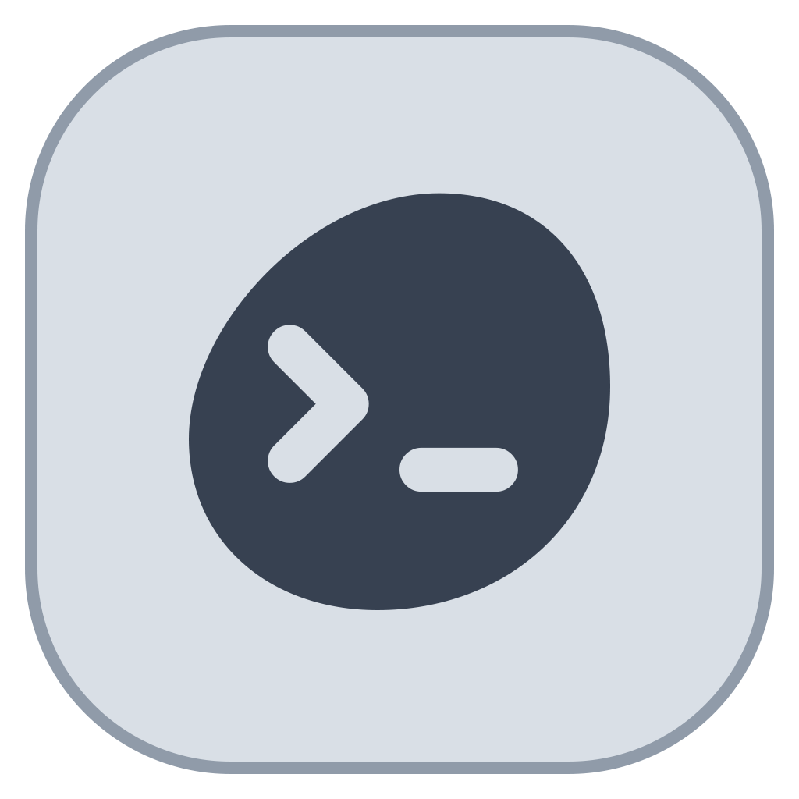
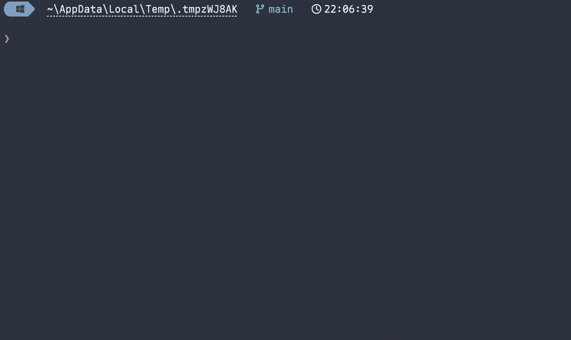
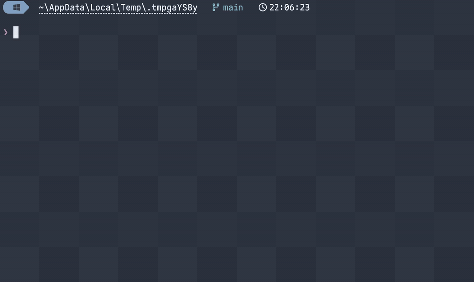

<p align="center">
  
</p>

<h1 align="center">Pebrel</h1>

<p align="center">
  <strong>GPU 加速终端、SSH 工作区，以及你的 AI CLI 会话空间。</strong>
</p>

<p align="center">
  使用 Rust 与 GPUI 构建，面向 Windows、macOS 和 Linux。<br />
  分屏终端 · SSH 与 SFTP · Claude Code 与 Codex 工作流 · 原生文档阅读
</p>

<p align="center">
  <a href="https://trendshift.io/repositories/127463?utm_source=trendshift-badge&amp;utm_medium=badge&amp;utm_campaign=badge-trendshift-127463" target="_blank" rel="noopener noreferrer"></a>
</p>

<p align="center">
  <a href="https://pebrel.com"></a>
  
  <a href="https://atomgit.com/kettys/pebrel"></a>
  <a href="https://hub.xerj.org/contributors/Kuddev"></a>
  
  
  <a href="https://discord.gg/VFn4rcxmhn"></a>
  <a href="https://linux.do"></a>
</p>

<p align="center">
  <a href="README.md">English</a> · <strong>简体中文</strong> · <a href="README.ja.md">日本語</a>
</p>

---

<p align="center">
  
</p>

<p align="center">
  
</p>

<p align="center">
  
</p>

## 💖 赞助商

<table>
  <tr>
    <td align="center" width="240">
      <a href="https://cn.aiapi.bot/invite?code=MCYLZ5H6FR"></a><br />
      <a href="https://cn.aiapi.bot/invite?code=MCYLZ5H6FR"><strong>AIAPI</strong></a>
    </td>
    <td>
      <p><strong>感谢 AIAPI 对本项目的强力支持！</strong></p>
      <p>AIAPI 致力于打造全网最稳定的 AI 模型中转站，面向个人开发者、技术团队与企业提供一站式统一接口。我们主打满血 Claude、满血 GPT 等顶尖模型，坚持原汁原味、绝不降智、不掺一滴水。依托动态多路调度保障高可用，性能、响应耗时与账单全程透明；配备顶级售后团队，问题极速响应、全程保驾护航。根据模型与路由策略，调用成本比官方基准价直降 40%–98%。</p>
      <p><a href="https://cn.aiapi.bot/invite?code=MCYLZ5H6FR">访问 AIAPI</a></p>
    </td>
  </tr>
  <tr>
    <td align="center" width="240">
      <a href="https://sidrune.ai/register?source=github&campaign=pebrel&promo=pebrel"></a><br />
      <a href="https://sidrune.ai/register?source=github&campaign=pebrel&promo=pebrel"><strong>Sidrune AI</strong></a>
    </td>
    <td>
      <p><strong>一个入口，接入并管理全球主流 AI 模型</strong></p>
      <p>感谢 Sidrune AI 赞助本项目！Sidrune AI 面向个人开发者、技术团队与企业，通过统一 API 接入并管理全球主流 AI 模型；通过多线路动态调度提升可用性，模型表现、响应时间与费用透明可查。根据不同模型与线路，API 调用成本较官方或基准价格可降低 40%—98%。</p>
      <p><a href="https://sidrune.ai/register?source=github&campaign=pebrel&promo=pebrel">立即访问并注册</a>，即可获得 $3 API 额度。</p>
    </td>
  </tr>
</table>

商业合作或赞助，请联系：[fickleheartedkeys@163.com](mailto:fickleheartedkeys@163.com)

<p align="center">
  <strong>Pebrel 微信交流群</strong>
</p>

<p align="center">
  <a href="extra/community/wechat-group-2026-11-11.jpg"></a>
</p>

<p align="center">
  微信扫码加入，2026 年 11 月 11 日前有效。点击图片可查看原图。
</p>

## 一个工作区

Pebrel（原名 Nebula）把本地 Shell、远程主机、文件和 AI 命令行工具放进同一个原生桌面工作区。
通过标签和分屏组织终端，关注各个 Agent 的活动，并直接在应用中阅读输出。

### 终端与会话

- 侧栏或顶部标签、可拖拽分屏，以及各窗格独立的工作目录。
- 保存工作区布局，可选恢复 AI 对话。在 WSL 与 Linux 中，Codex 的 hook 未上报 ID 时，
  可从当前会话元数据补全身份。
- Windows 原生 Codex 身份刷新复用后台辅助进程，并禁用启动光标提示。每次仍读取当前
  元数据并限制等待时间；辅助进程卡住时先终止，后续刷新再创建替代进程。
- Windows 下可选择后台驻留，让关窗后的会话继续运行。进程退出后重新接续已保存的对话
  是另一项功能，需要 CLI 支持恢复，并且有可用的会话身份。
- 智能补齐与历史补齐、自定义快捷键，以及集成的 Shell 提示符。
- 在受支持的 Bash/Readline、Zsh/ZLE 和 PowerShell/PSReadLine 提示符中，点击移动光标，
  拖选输入后删除，保留 Shell 原生编辑与撤销；不支持的键位模式和无法确认的布局仍使用终端选区。
- 显示通过 Kitty 图形协议直接传输的未压缩 RGB/RGBA 图像，同时保留 OSC 1337 支持。
  存储与传输有界；暂不支持 PNG 载荷、文件或共享内存传输、Unicode 占位符及动画。
- 命令列表支持复选框多选和一次确认批量删除，无需再逐条确认。多选模式下不会执行
  命令，切换搜索或文件夹会清空选择。“选择当前列表”包含当前筛选下滚动区外的命令。
  “管理 → 删除全部命令”不受当前搜索或文件夹限制，会清除全部自定义命令及所有平台
  当前提供的内置命令，保留文件夹。清空内置命令也包含已移到其他文件夹的内置命令；
  空的内置文件夹会隐藏，可通过“管理 → 恢复内置命令”恢复到默认分组。自定义命令
  删除后无法在此撤销；删除自定义文件夹需确认，其中的命令会保留并移到“未分组”。
  批量操作复用原有加锁、重新读盘、原子写入事务，文件格式不变，陈旧选择不会覆盖
  其他窗口对无关命令的修改。
- 终端快捷键的改绑或清空会保留名称、命令等输入框自身的粘贴键；恢复默认立即作用于
  当前应用窗口，无需重启。运行时改为替换旧覆盖规则，避免追加方式留下禁用记录，
  配置文件格式保持兼容。详见[快捷键归属说明](architecture/notes/nebula_app/gpui_shell/workspace/2026-10-07-keyboard-override-sources.md)。
- Windows 本地 PowerShell 提示符支持将多行剪贴板粘贴保留在 PSReadLine 中检查，
  按 Enter 才提交，一次撤销可移除整次粘贴。需要 Shell 集成生效且托管粘贴键没有被用户占用。
  PSReadLine 会统一 CRLF 换行并将 Tab 展开为四个空格；其他编辑器沿用已协商的粘贴协议
  或现有确认行为。详见[剪贴板粘贴边界](architecture/notes/nebula_app/gpui_shell/terminal/view/2026-10-23-powershell-clipboard-paste.md)。

### 智能补齐

从当前 Git 仓库、项目脚本、SSH 配置和文件系统获取候选，第一次输入命令也能补齐。
Windows 下还支持已注册的 WSL 发行版。这些候选由 Pebrel 自带的补齐引擎提供，
无需 Shell 补齐插件或 AI 请求。

下面在真实 Windows/PowerShell 终端中演示五种命令：Git 分支、npm 脚本、SSH 别名、
WSL 发行版，以及 `cat` 读取带空格的文件名。使用内置 Powerline 提示符，逐字连续输入。

<p align="center">
  
</p>

设置中可选择**行内补齐**（Tab 接受灰字）、**列表补齐**（Tab 接受选中候选），
或**混合补齐**（→ 接受灰字，Tab 打开列表）。

在设置中选择命令 AI 的服务商和模型后，可在已集成的本地 zsh、Bash 4+ 或 PowerShell
提示符处按 **Cmd+Shift+A**（macOS）或 **Ctrl+Shift+A**（Windows/Linux），用自然语言
搜索命令。当前行会带入为搜索词，Enter 生成、Tab 采用但不执行、Esc 返回原草稿。
仅当前输入、操作系统和 Shell 类型会发送给所选服务商；暂不支持 WSL 和 SSH。

AI 命令后缀预测需单独开启，默认关闭。在启用本地补齐的已验证本地提示符中，
非空命令空闲 500 毫秒且本地来源没有合适候选后，可显示带 AI 标识的后缀。
Tab/→ 沿用当前补齐模式，Esc 隐藏预测，仍需单独按 Enter 执行。
仅发送当前输入、操作系统和 Shell 类型；暂不支持 WSL 和 SSH。

在已集成的本地 zsh 历史提示中，保留 Shell 原生灰字，并在独立列表同时查看历史与 AI 候选。
命令 AI 设置可分别选择 Tab、→ 接受哪个来源（默认分别为 AI、历史）；点击或用 ↑/↓ 选择候选后，
两个接受键均以手选结果为准，采用不会执行。原生历史提示仅在本地使用，不发送给模型；并列模式下即使已有历史候选，也会请求 AI。

Pebrel 能查询窗格的文件系统时，`nvim`、`code` 和 `cat` 的文件参数从当前目录获取候选，
历史只给已发现的候选排序。需要在多个文件间选择时，选用**混合补齐**：
Tab 打开列表，再次按 Tab 轮换候选，Enter 插入选中项但不执行命令；→ 直接接受灰字。

<details>
<summary>历史补齐有什么不同？</summary>

历史补齐回填已经执行过的命令。下面先运行 `echo deployment finished`，再输入
`echo dep` 从历史中补齐；上面的五个例子则从当前环境发现候选，无需相应的命令历史。

<p align="center">
  
</p>

</details>

### SSH 与文件

- 主机页、启动器、命令面板和 Quick Jump 均可按名称、地址、分组、标签和备注搜索 SSH 主机。
  空格分隔的关键词需同时匹配，搜索不区分大小写；启动入口现与主机页使用相同的搜索字段。
- 保存主机、读取 SSH 配置别名、设置代理与跳板，支持私钥和交互式认证，并验证主机密钥。
- SFTP 文件浏览、上传下载、文件夹传输、进度显示与取消；支持 Ctrl/Shift 选择后批量下载，
  悬停操作、远端复制粘贴及拖出下载。上传/下载快捷键要求远端文件列表获得焦点。
- 加载期间预览远端 UTF-8 文档；完整校验后，可编辑并保存不超过 8 MiB 的文本，保留 BOM
  与换行格式。无效或超限文本保持只读，服务端文件变化时拒绝冲突保存。
- 双击远端 PNG、JPEG、WebP、BMP 或 GIF 文件预览图片，提供进度、取消与重试；GIF 使用首帧。
  图片源文件上限为 64 MiB，解码帧上限为 128 MiB。
- 在终端旁浏览本地文件并执行 Git 操作。
- 复制 WSL 与 SSH 标签时保留已知工作目录。

<p align="center">
  
</p>

### AI CLI 工作流

- Claude Code、Codex 等可识别的 CLI 显示各自图标与活动状态；受支持的 hook 事件提供更准确的进度和待处理信号。
- 任务名称去除重复的 CLI 转圈与进度装饰；明确上报的运行、权限/输入请求和完成事件保留
  对应状态指示。完整 hook 生命周期不会被静默时间或屏幕猜测覆盖。
- 受支持的 SSH 持久会话重新挂接 Agent hook，并跟随活动窗格的任务身份。需要已安装 Python
  集成且能够确认 POSIX 客户端身份；暂不覆盖嵌套服务会话与非 POSIX 主机。
- 对通过 Pebrel 本地启动或恢复的受支持 Claude Code、Pi 和 OpenCode 会话，可在输入为空时
  基于近期对话提供下一条消息建议。预测默认关闭，可单独使用服务商/模型，不改变 Agent 主模型，
  适配器随应用提供。
- 通知跟随来源窗格，点击即可返回对应终端。
- 已捕获的 Claude Code 与 Codex 回答可在阅读器中打开，支持 Markdown、公式、原文和本地图片预览。
  阅读器控件与提示随所选语言显示；复制原文保留完整回答。详见[阅读器语言说明](docs/answer-reader-language.md)。
- 剪贴板图片会保存为 PNG，并把路径插入本地、WSL 或 SSH 会话。终端内直接显示图片需要 CLI
  输出 OSC 1337、Kitty protocol（APC，直接传输 RGB/RGBA）或 Sixel（7 位 DCS）协议；
  附件缩略图取决于 CLI 自身。

<p align="center">
  
</p>

### 原生、可配置的界面

- GPU 加速的 GPUI 界面、浅色与深色主题、背景及不透明度设置。
- 应用图标配色与十一种界面语言，未翻译内容回退英文。
- 工作区对话框、命令操作反馈、Git/SVN 控件与默认通知随所选语言显示；切换语言保留
  命令搜索内容与选区。详见[多语言说明](docs/internationalization.md)。
- 可搜索的设置、命令面板，以及支持检查和热重载的 Luau 配置；兼容旧 `.lua` 文件名，
  但使用 Luau 的语法和标准库，不保证 Lua 5.4 全量兼容。已有 TOML 配置仍可使用。
- 在分组行的铅笔按钮上重命名已保存的命令组；内置分组与未分组条目不能改名，重复或
  非法名称会被拒绝，组内已有命令不受影响。
- 在 `pebrel.luau` 中配置原生字体、标签/侧栏、不透明度与窗格默认值；设置界面已保存的值
  优先，修改脚本后需重启生效。
- 使用 GLSL（`.glsl`/`.frag`）或 WGSL 背景/终端效果，并配置动画速度、帧率与数值参数。
  效果需要显式启用，终端 shader 按列表顺序运行。
- Markdown 文档标签与原生数学公式排版，不依赖 WebView。

<p align="center">
  
</p>

<p align="center">
  
</p>

## 下载

从 **[最新发布](https://github.com/Attiv/pebrel/releases/latest)** 选择对应安装包。本 fork 的 2.4.0 只发布 Windows 与 macOS 包。

| 系统 | 架构 | 安装包 |
| --- | --- | --- |
| Windows 10 1809+ / 11 | x64 | `.exe` 安装器、`.zip` 便携包 |
| Windows 11 | ARM64 | 安装器 `.exe`、便携 `.zip` |
| macOS Preview，部署目标为 14+ | Apple Silicon / arm64 | `.dmg` |
| macOS Preview，部署目标为 14+ | Intel / x64 | `.dmg` |

安装包统一采用 `Pebrel-v<版本>-<系统>-<架构>` 命名，Windows 安装器以 `-setup.exe` 结尾。
Windows 为正式版，Linux 与 macOS 文件名在扩展名前带有 `-preview` 标记。
1.7.0 以前的历史发布还包含旧名称安装器，用于兼容旧版自动更新客户端。

Windows 可运行安装器，或解压 ZIP 后启动 `pebrel.exe`，保留随包目录结构。
Linux 可安装 DEB，或为 AppImage 添加执行权限。macOS 打开对应 DMG，把 Pebrel 拖入“应用程序”。
采用临时签名的 macOS 包首次启动可能需要在“系统设置 > 隐私与安全性”中选择“仍要打开”。
原生 macOS CI 使用 macOS 26 runner，部署目标并不代表每个较早系统版本都已通过运行验证。

Pebrel 2.1 在 Windows、macOS 和 Linux 上接通原生托盘操作、快速终端快捷键、登录自启和
本地 AI Hook 配置。Linux 托盘使用状态通知器，Wayland 快捷键使用桌面 Portal。
Windows 与 macOS 提供原生更新安装；Linux 通过包管理器或新安装包升级。
平台要求和旧版 Nebula 升级步骤见[安装说明](INSTALL.md)。

## 自建中转

在手机端先添加 SSH 主机，选择密码或私钥认证，再到中转安装页选择该主机。
密钥认证的输入框用于私钥口令，未加密私钥留空；它不是中转连接密码。
安装后，在电脑“设置 → 手机连接 → 中转服务器”选择这台 SSH 主机，再生成
配对二维码供手机扫描。

手动安装的服务器要求、校验及管理步骤见
[离线中转安装说明](mobile/relay-native/INSTALL.md)。v2.1.1 最初的 Release
资产没有离线中转包；包含上述安装器的源码提供 `mobile/tools/package_manual_relay.py`，
可从经过校验的 APK 生成两种 Linux 架构的离线包和 SHA256 校验文件。
旧 APK 还需配套源码生成的 Cargo 依赖许可材料，具体命令见上述说明。
这个工具不下载可执行文件，也不会自动发布或替换 Release 资产。

## 配置

```sh
pebrel config init --language zh-CN
pebrel config check
```

生成的 Luau 配置使用 `require 'pebrel'` 与 `pebrel.config_builder()`。
重载失败时继续使用上一份有效配置。设置与示例见 [Luau 配置指南](docs/lua-configuration.md)。

在 **设置 → 终端 → 提醒** 中，**通知显示时长** 可选择 **保留原有时长**、
5、10、30、90 秒，或 **保持常驻**。默认保留已有行为：短提示显示 5 秒，消息
提醒显示 90 秒，更新通知保持常驻。该选项独立于是否显示 AI 提醒的开关，保存后
对所有新显示或刷新的应用内卡片生效。包括常驻模式在内，仅保留最新三条卡片；
新卡片替换更早的卡片时不会执行其操作。隐藏卡片不会同意或拒绝请求，也不会改变
任务状态；请求仍可在对应终端中处理，更新仍可在设置中查看。系统通知不受影响。
持久化键为 `notification_duration`，可取 `default`、`5`、`10`、`30`、`90`
或 `persistent`。
可查看[通知显示时长菜单示例](docs/screenshots/notification-duration.png)。

## 构建

安装项目固定的 Rust 工具链与对应平台依赖后运行：

```sh
cargo build --release --locked -p nebula --bin pebrel --features gpui-shell
```

内部 Cargo 包名仍为 `nebula`，应用与命令名为 `pebrel`。GPUI 是正式产品界面，
旧渲染器仅在显式启用 `legacy-shell` 时使用。

## 联系方式

Discord：[discord.gg/VFn4rcxmhn](https://discord.gg/VFn4rcxmhn)

## 致谢

Pebrel 使用了第三方终端、界面和字体组件。组件来源、版权与许可证声明统一保留在
[THIRD-PARTY-NOTICES](THIRD-PARTY-NOTICES) 和 [licenses/](licenses/) 中。

<p>感谢 <a href="https://molchuan.com/"><picture>
  <source media="(prefers-color-scheme: dark)" srcset="extra/logo/acknowledgement_1molchuan_dark.png">
  
</picture></a> 为 Pebrel 的开发提供额外支持。</p>

## 友情链接

- **[linux.do](https://linux.do)** - 新的理想型社区。

## ⭐ Star History

<a href="https://star-history.com/#Kuddev/pebrel&Date">
  <picture>
    <source media="(prefers-color-scheme: dark)" srcset="https://api.star-history.com/svg?repos=Kuddev/pebrel&type=Date&theme=dark" />
    <source media="(prefers-color-scheme: light)" srcset="https://api.star-history.com/svg?repos=Kuddev/pebrel&type=Date" />
    
  </picture>
</a>
